<!-- Styled with GitSkins Repo Skins (https://gitskins.blessc.com) · Theme: swiss-bauhaus-pixel -->

<p>
  <a href="https://gitskins.blessc.com">
    <picture>
      <source media="(prefers-color-scheme: dark)" srcset="./assets/repo-hero-dark.svg">
      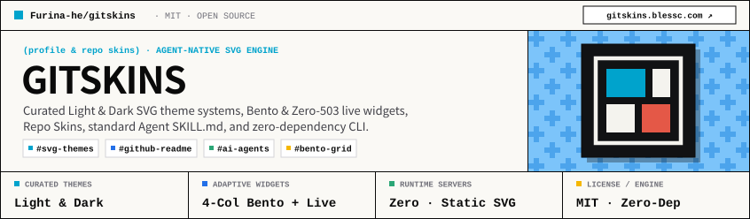
    </picture>
  </a>
</p>

<div align="center">

<p><strong>Deterministic Light &amp; Dark SVG theme systems, 4-column Bento &amp; Zero-503 live widgets, and Repo Skins — built for developers &amp; AI coding agents.</strong></p>

<p>
  <a href="https://gitskins.blessc.com"></a>
  <a href="https://github.com/Furina-he/gitskins/stargazers"></a>
  <a href="https://github.com/Furina-he/gitskins/network/members"></a>
  <a href="#theme-gallery"></a>
  <a href="#theme-adaptive-widgets"></a>
  <a href="LICENSE"></a>
</p>

<p>
  <a href="https://gitskins.blessc.com"><strong>Live Studio ↗</strong></a>
  ·
  <a href="#theme-gallery">Theme Gallery</a>
  ·
  <a href="#theme-adaptive-widgets">Widgets</a>
  ·
  <a href="#quick-start">Quick Start</a>
  ·
  <a href="#architecture">Architecture</a>
  ·
  <a href="skill/gitskins/SKILL.md">Agent SKILL.md</a>
  ·
  <a href="ROADMAP.md">Roadmap</a>
</p>

<p>
  <strong>English</strong> · <a href="README_ZH.md">简体中文</a>
</p>

</div>

<p>
  <picture>
    <source media="(prefers-color-scheme: dark)" srcset="./assets/repo-install-dark.svg">
    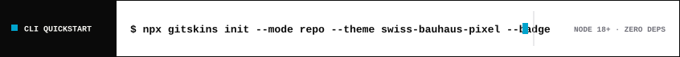
  </picture>
</p>

---

## Why GitSkins?

Most GitHub Profiles and Repo READMEs rely on brittle third-party stat servers that hit rate limits (`503`), clash visually across mismatched badge styles, or break in Dark Mode.

**GitSkins treats your GitHub README as a deterministic, zero-runtime design system** — shipping static XML-validated Light & Dark SVGs, a `846px` 4-column Bento engine, GitHub Actions live widgets, and native `SKILL.md` prompts for AI coding agents.

| Dimension | **GitSkins** | Hosted Stat Card APIs | Hand-Coded SVGs |
| :--- | :--- | :--- | :--- |
| **Uptime & Reliability** | **100% Static SVG** in your repo (Zero `503` / zero rate limits) | Frequent Vercel cold starts, quotas & outages | Static, but tedious to keep updated |
| **Light & Dark Parity** | **14 semantic tokens** per theme with native `<picture>` pairs | Single palette or crude inversion | Manual duplication |
| **Visual Cohesion** | Unified **Profile + Repo + Bento + Live Widgets** across 11 skins | Mismatched colors, fonts, and border radii | Hard to scale across modules |
| **AI Agent Workflow** | Native **`SKILL.md` + Zero-Config Prompts + CLI** (facts auto-detected) | Manual URL query tweaking | Prone to broken XML & coordinate drift |
| **Hosting Cost & Safety** | **$0** (GitHub Actions stdlib Python), zero `<script>`, strict XML | Requires third-party or self-hosted backend | Zero cost, high maintenance |

---

<p>
  <picture>
    <source media="(prefers-color-scheme: dark)" srcset="./assets/repo-sec-feat-dark.svg">
    
  </picture>
</p>

<p>
  <picture><source media="(prefers-color-scheme: dark)" srcset="./assets/repo-feat-01-dark.svg">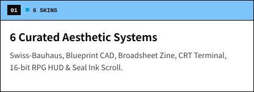</picture>&nbsp;<picture><source media="(prefers-color-scheme: dark)" srcset="./assets/repo-feat-02-dark.svg">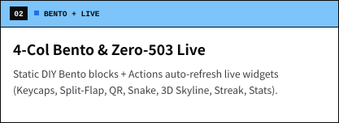</picture>
</p>

<p>
  <picture><source media="(prefers-color-scheme: dark)" srcset="./assets/repo-feat-03-dark.svg"></picture>&nbsp;<picture><source media="(prefers-color-scheme: dark)" srcset="./assets/repo-feat-04-dark.svg">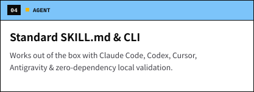</picture>
</p>

---

## Theme Gallery

Every theme ships with paired **Light & Dark** semantic token contracts (`meta.json#tokens`), strict XML-validated static SVGs (`22` per theme = `242` SVGs), and seamless reskinning across **Profile Skins**, **Repo Skins**, **DIY Bento Widgets**, and **Zero-503 Live Widgets**. Toggle your GitHub color scheme to see every preview below adapt natively:

<table>
  <tr>
    <td width="50%" valign="top">
      <a href="https://gitskins.blessc.com/#swiss-bauhaus-pixel">
        <picture>
          <source media="(prefers-color-scheme: dark)" srcset="./themes/swiss-bauhaus-pixel/assets/hero-dark.svg">
          
        </picture>
      </a>
      <br>
      <strong><code>01</code> Swiss-Bauhaus Pixel Poster</strong><br>
      <sub><code>0px</code> Swiss grid, 9-row pixel wordmark, orthogonal weaves &amp; blinking <code>28×28</code> avatar. Best for indie devs &amp; design engineers.</sub><br>
      <sub><a href="https://gitskins.blessc.com/#swiss-bauhaus-pixel">Live Preview ↗</a> · <a href="themes/swiss-bauhaus-pixel/SPEC.md">SPEC</a> · <a href="themes/swiss-bauhaus-pixel/PROMPT.md">PROMPT</a> · <a href="themes/swiss-bauhaus-pixel/generator.py">Generator</a></sub>
    </td>
    <td width="50%" valign="top">
      <a href="https://gitskins.blessc.com/#blueprint-cad">
        <picture>
          <source media="(prefers-color-scheme: dark)" srcset="./themes/blueprint-cad/assets/hero-dark.svg">
          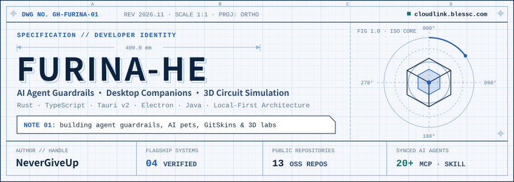
        </picture>
      </a>
      <br>
      <strong><code>02</code> Architectural Blueprint CAD</strong><br>
      <sub>Prussian blueprint &amp; vellum tracing sheet, millimeter grid, isometric reticle &amp; CAD title blocks. Best for systems, Rust/Go &amp; infra engineers.</sub><br>
      <sub><a href="https://gitskins.blessc.com/#blueprint-cad">Live Preview ↗</a> · <a href="themes/blueprint-cad/SPEC.md">SPEC</a> · <a href="themes/blueprint-cad/PROMPT.md">PROMPT</a> · <a href="themes/blueprint-cad/generator.py">Generator</a></sub>
    </td>
  </tr>
  <tr>
    <td width="50%" valign="top">
      <a href="https://gitskins.blessc.com/#editorial-zine">
        <picture>
          <source media="(prefers-color-scheme: dark)" srcset="./themes/editorial-zine/assets/hero-dark.svg">
          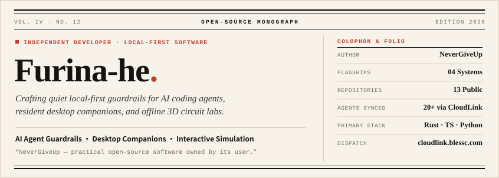
        </picture>
      </a>
      <br>
      <strong><code>03</code> Editorial Broadsheet Zine</strong><br>
      <sub>Archival newsprint &amp; obsidian press, double-rule masthead, serif headlines &amp; colophon ledger. Best for writers, architects &amp; OSS maintainers.</sub><br>
      <sub><a href="https://gitskins.blessc.com/#editorial-zine">Live Preview ↗</a> · <a href="themes/editorial-zine/SPEC.md">SPEC</a> · <a href="themes/editorial-zine/PROMPT.md">PROMPT</a> · <a href="themes/editorial-zine/generator.py">Generator</a></sub>
    </td>
    <td width="50%" valign="top">
      <a href="https://gitskins.blessc.com/#crt-terminal">
        <picture>
          <source media="(prefers-color-scheme: dark)" srcset="./themes/crt-terminal/assets/hero-dark.svg">
          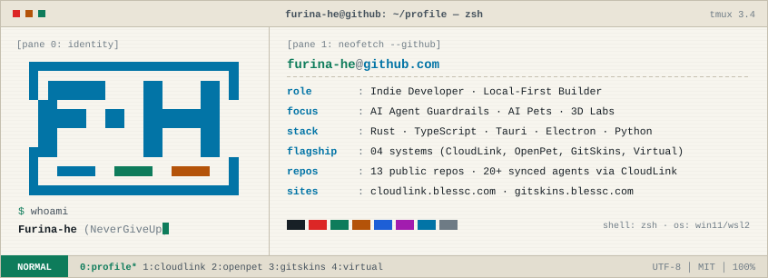
        </picture>
      </a>
      <br>
      <strong><code>04</code> Retro CRT Terminal TUI</strong><br>
      <sub>Split-pane <code>tmux</code> workstation, pixel monogram, <code>neofetch</code> telemetry &amp; ANSI 8-color bar. Best for CLI authors, Linux/Neovim &amp; DevOps.</sub><br>
      <sub><a href="https://gitskins.blessc.com/#crt-terminal">Live Preview ↗</a> · <a href="themes/crt-terminal/SPEC.md">SPEC</a> · <a href="themes/crt-terminal/PROMPT.md">PROMPT</a> · <a href="themes/crt-terminal/generator.py">Generator</a></sub>
    </td>
  </tr>
  <tr>
    <td width="50%" valign="top">
      <a href="https://gitskins.blessc.com/#pixel-rpg-hud">
        <picture>
          <source media="(prefers-color-scheme: dark)" srcset="./themes/pixel-rpg-hud/assets/hero-dark.svg">
          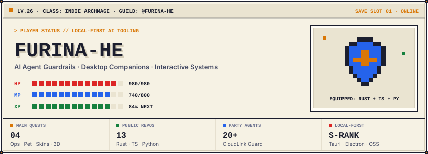
        </picture>
      </a>
      <br>
      <strong><code>05</code> 16-bit Pixel RPG HUD</strong><br>
      <sub>Stepped pixel bevel frames, corner rivets, HP/MP/XP stat meters &amp; quest-log cards with <code>12×12</code> relics. Best for game &amp; creative devs.</sub><br>
      <sub><a href="https://gitskins.blessc.com/#pixel-rpg-hud">Live Preview ↗</a> · <a href="themes/pixel-rpg-hud/SPEC.md">SPEC</a> · <a href="themes/pixel-rpg-hud/PROMPT.md">PROMPT</a> · <a href="themes/pixel-rpg-hud/generator.py">Generator</a></sub>
    </td>
    <td width="50%" valign="top">
      <a href="https://gitskins.blessc.com/#seal-ink-scroll">
        <picture>
          <source media="(prefers-color-scheme: dark)" srcset="./themes/seal-ink-scroll/assets/hero-dark.svg">
          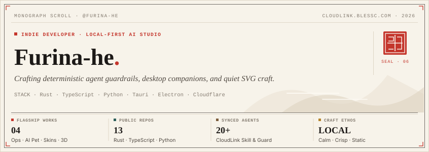
        </picture>
      </a>
      <br>
      <strong><code>06</code> Seal Ink Monograph</strong><br>
      <sub>Warm Xuan paper &amp; obsidian inkstone, carved cinnabar seal stamp, corner fretwork &amp; layered mountain mist. Best for East Asian minimalism lovers.</sub><br>
      <sub><a href="https://gitskins.blessc.com/#seal-ink-scroll">Live Preview ↗</a> · <a href="themes/seal-ink-scroll/SPEC.md">SPEC</a> · <a href="themes/seal-ink-scroll/PROMPT.md">PROMPT</a> · <a href="themes/seal-ink-scroll/generator.py">Generator</a></sub>
    </td>
  </tr>
  <tr>
    <td width="50%" valign="top">
      <a href="https://gitskins.blessc.com/#synth-hardware">
        <picture>
          <source media="(prefers-color-scheme: dark)" srcset="./themes/synth-hardware/assets/hero-dark.svg">
          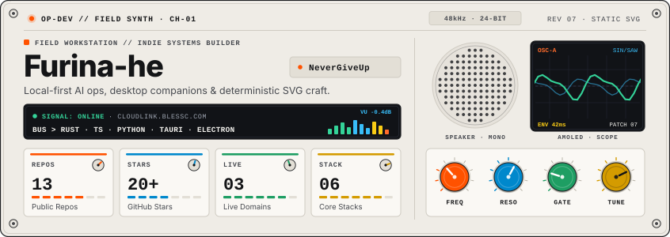
        </picture>
      </a>
      <br>
      <strong><code>07</code> Tactile Industrial Synth</strong><br>
      <sub>OP-1 / Braun brushed chassis, perforated speaker grill, OLED waveform &amp; 4 color-coded rotary encoders. Best for hardware, audio &amp; creative engineers.</sub><br>
      <sub><a href="https://gitskins.blessc.com/#synth-hardware">Live Preview ↗</a> · <a href="themes/synth-hardware/SPEC.md">SPEC</a> · <a href="themes/synth-hardware/PROMPT.md">PROMPT</a> · <a href="themes/synth-hardware/generator.py">Generator</a></sub>
    </td>
    <td width="50%" valign="top">
      <a href="https://gitskins.blessc.com/#pcb-solder-mask">
        <picture>
          <source media="(prefers-color-scheme: dark)" srcset="./themes/pcb-solder-mask/assets/hero-dark.svg">
          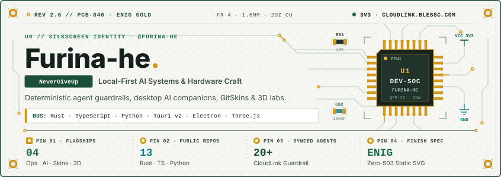
        </picture>
      </a>
      <br>
      <strong><code>08</code> Solder Mask PCB</strong><br>
      <sub>Matte white &amp; deep emerald solder mask, ENIG gold vias (<code>◎</code>), 45° copper traces &amp; QFP IC chip packages. Best for embedded, robotics &amp; systems devs.</sub><br>
      <sub><a href="https://gitskins.blessc.com/#pcb-solder-mask">Live Preview ↗</a> · <a href="themes/pcb-solder-mask/SPEC.md">SPEC</a> · <a href="themes/pcb-solder-mask/PROMPT.md">PROMPT</a> · <a href="themes/pcb-solder-mask/generator.py">Generator</a></sub>
    </td>
  </tr>
  <tr>
    <td width="50%" valign="top">
      <a href="https://gitskins.blessc.com/#transit-boarding">
        <picture>
          <source media="(prefers-color-scheme: dark)" srcset="./themes/transit-boarding/assets/hero-dark.svg">
          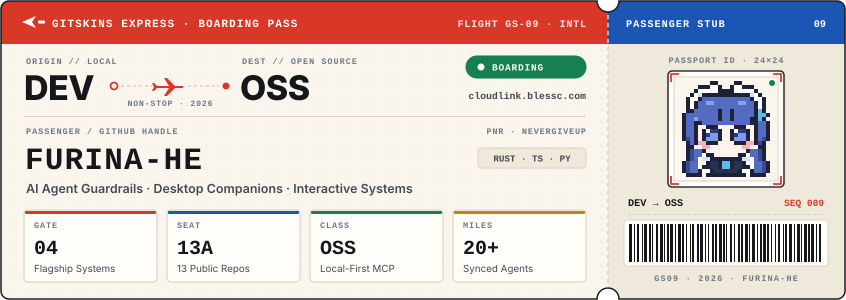
        </picture>
      </a>
      <br>
      <strong><code>09</code> Transit &amp; Boarding Pass</strong><br>
      <sub>Perforated thermal ticket &amp; nocturnal departure board, passport pixel avatar, barcode stub &amp; metro line cards. Best for global &amp; product devs.</sub><br>
      <sub><a href="https://gitskins.blessc.com/#transit-boarding">Live Preview ↗</a> · <a href="themes/transit-boarding/SPEC.md">SPEC</a> · <a href="themes/transit-boarding/PROMPT.md">PROMPT</a> · <a href="themes/transit-boarding/generator.py">Generator</a></sub>
    </td>
    <td width="50%" valign="top">
      <a href="https://gitskins.blessc.com/#classic-desktop-os">
        <picture>
          <source media="(prefers-color-scheme: dark)" srcset="./themes/classic-desktop-os/assets/hero-dark.svg">
          
        </picture>
      </a>
      <br>
      <strong><code>10</code> Classic Desktop OS</strong><br>
      <sub>System 7 Platinum &amp; NeXTSTEP dark workstation, 1-bit dither backdrop, pin-stripe windows &amp; pixel app icons. Best for macOS, desktop &amp; retro OS fans.</sub><br>
      <sub><a href="https://gitskins.blessc.com/#classic-desktop-os">Live Preview ↗</a> · <a href="themes/classic-desktop-os/SPEC.md">SPEC</a> · <a href="themes/classic-desktop-os/PROMPT.md">PROMPT</a> · <a href="themes/classic-desktop-os/generator.py">Generator</a></sub>
    </td>
  </tr>
  <tr>
    <td width="50%" valign="top">
      <a href="https://gitskins.blessc.com/#riso-duotone">
        <picture>
          <source media="(prefers-color-scheme: dark)" srcset="./themes/riso-duotone/assets/hero-dark.svg">
          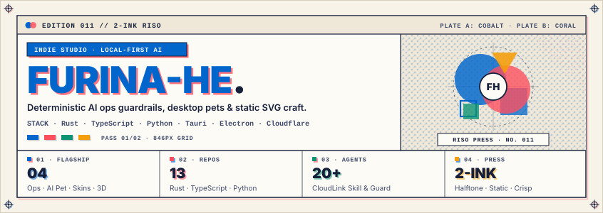
        </picture>
      </a>
      <br>
      <strong><code>11</code> Risograph Overprint Poster</strong><br>
      <sub>Misregistered 2-ink duotone shadows (Cobalt × Coral / Cyan × Pink), halftone dot screens &amp; print registration marks. Best for creative &amp; frontend devs.</sub><br>
      <sub><a href="https://gitskins.blessc.com/#riso-duotone">Live Preview ↗</a> · <a href="themes/riso-duotone/SPEC.md">SPEC</a> · <a href="themes/riso-duotone/PROMPT.md">PROMPT</a> · <a href="themes/riso-duotone/generator.py">Generator</a></sub>
    </td>
    <td width="50%" valign="middle" align="center">
      <strong>+ Submit Your Skin via PR</strong><br>
      <sub>Drop a self-contained folder under <code>themes/&lt;id&gt;/</code> and run <code>python scripts/build_all.py</code> to validate &amp; publish.</sub><br><br>
      <sub><a href="CONTRIBUTING.md">Read CONTRIBUTING.md ↗</a> · <a href="https://gitskins.blessc.com">Open Live Studio ↗</a></sub>
    </td>
  </tr>
</table>

---

## Theme-Adaptive Widgets

All **22 widgets** snap onto a pixel-exact **4-column `846px` Bento Grid** (`204 / 418 / 632 / 846px`, uniform `160px` row height) and automatically inherit all 14 semantic tokens of your active skin.

### Static DIY Widgets (`W01`–`W12`) — Instant Zero-Backend Export

| Code | Widget | Layout | Highlights |
| :--- | :--- | :--- | :--- |
| `W01` | `pixel-companion` | 1–2 col Bento | Animated desk companion with custom speech bubble |
| `W02` | `now-playing` | 2–4 col Bento | Cassette / vinyl deck for your current loop track |
| `W03` | `dev-badge` | 2–4 col Bento | Geek ID badge: building now, timezone, status & meter |
| `W04` | `skill-dock` | 2–4 col Bento | Skin-matched tech stack rack (no clashing third-party pills) |
| `W05` | `quote-banner` | 2–4 col Bento | Minimalist manifesto / terminal motto banner |
| `W06` | `hero-sticker` | Hero Overlay | Embeds directly onto Hero corners (peeking cat, seal, coffee, radar) |
| `W07` | `pixel-runway` | `846×48` Strip | Animated pixel patrol runway / LED ticker divider |
| `W08` | `mini-tile` | `204×160` Tile | Compact coffee, weather window, hourglass, or synth tile |
| `W09` | `keycap-rig` | 2–4 col Bento | Sculpted 3D mechanical keycaps & hardware rig deck |
| `W10` | `split-flap` | 2–4 col Bento | Hinged airport split-flap departure board for status & goals |
| `W11` | `skill-radar` | 1–2 col Bento | 6-axis hexagonal ability radar synced to theme tokens |
| `W12` | `qr-pass` | 1–2 col Bento | Genuine ISO-18004 scannable vector QR code (`<path>`) pass |

### Zero-503 Live Widgets (`L01`–`L10`) — Auto-Refreshed via GitHub Actions

Powered by a single zero-dependency Python stdlib script ([live-widgets/generate_live_widgets.py](live-widgets/generate_live_widgets.py)) running on schedule inside your own repo — **no external server, no 503 downtime**:

| Code | Widget | Data Displayed | External Secrets |
| :--- | :--- | :--- | :--- |
| `L01` | `github-stats` | Stars, Repos, Followers, Merged PRs & language bar | Built-in `GITHUB_TOKEN` only |
| `L02` | `coding-rhythm` | 24-hour commit histogram & Early Bird / Night Owl badge | Built-in `GITHUB_TOKEN` only |
| `L03` | `rss-feed` | Latest 3 articles from any RSS 2.0 / Atom blog feed | None (pass `--rss-url`) |
| `L04` | `live-weather` | Real-time temperature & animated pixel sky via Open-Meteo | None (free, no API key) |
| `L05` | `wakatime-weekly` | 7-day coding hours, daily average & top languages | Optional `WAKATIME_API_KEY` |
| `L06` | `spotify-recent` | Currently playing or recent track vinyl deck | Optional Spotify refresh token secrets |
| `L07` | `contribution-snake` | 53×7 GitHub contribution snake (`Platane/snk` themed palette or framed SVG) | Built-in `GITHUB_TOKEN` only |
| `L08` | `contrib-skyline` | Isometric 3D extruded contribution city skyline (14–18 weeks) | Built-in `GITHUB_TOKEN` only |
| `L09` | `commit-streak` | Current commit streak, longest record & 14-day pixel flame bar | Built-in `GITHUB_TOKEN` only |
| `L10` | `recent-activity` | Latest 3 public Push / Release / PR / Star events log | Built-in `GITHUB_TOKEN` only |

<details>
<summary><strong>How Zero-503 Live Widgets Refresh Automatically</strong></summary>

1. Export a workflow bundle from [gitskins.blessc.com/#widgets](https://gitskins.blessc.com/#widgets) or run `node cli/gitskins.mjs init --mode profile`.
2. GitHub Actions runs [`.github/workflows/gitskins-widgets.yml`](live-widgets/gitskins-widgets.yml) every 6 hours (or manually via `workflow_dispatch`).
3. `scripts/generate_live_widgets.py` fetches fresh metrics using Python's standard library only, writes XML-validated `assets/live-*-{light,dark}.svg`, and commits changes back only when diffs exist.

</details>

---

## Quick Start

Choose whichever workflow matches how you build:

### 1. Web Studio (No AI or Local Setup — 30 Seconds)

1. Open **[gitskins.blessc.com](https://gitskins.blessc.com)** and switch between **Profile Skins**, **Repo Skins**, and **DIY & Live Widgets**.
2. Enter any GitHub username or `owner/repo` for instant zero-backend live preview with your real avatar, stars, and repositories.
3. Tune accent color, card count, Bento layout, and motion, then click **Export ZIP** to download ready-to-push `README.md`, Light/Dark SVGs, and `.github/workflows/gitskins-widgets.yml`.

### 2. AI Coding Agents (`SKILL.md` & Zero-Config Prompts)

Works natively with **Claude Code**, **Codex**, **Cursor**, **Antigravity**, **Gemini CLI**, and **Windsurf**.

- **Standard Agent Skill**: Install [skill/gitskins/SKILL.md](skill/gitskins/SKILL.md) (also served live at `https://gitskins.blessc.com/skill/SKILL.md`).
- **One-Click Prompt**: Paste this into your AI coding agent inside your profile or project repo:

```text
Redesign my GitHub Profile README using the GitSkins "Swiss-Bauhaus Pixel Poster" theme.
Follow https://raw.githubusercontent.com/Furina-he/gitskins/main/themes/swiss-bauhaus-pixel/PROMPT.md
Auto-detect my GitHub username, avatar, and real repositories via gh/git config,
generate paired Light & Dark XML-validated SVGs, and verify zero overlaps before finishing.
```

### 3. Zero-Dependency CLI (`Node 18+`)

Clone once and run the self-contained ESM CLI with zero npm dependencies:

```bash
git clone https://github.com/Furina-he/gitskins.git
cd gitskins

# 1. List all 11 themes, 22 widgets, and Repo Skin modules
node cli/gitskins.mjs list

# 2. Scaffold a Repo Skin (Hero + Install + 4 Feature Cards + Architecture + Badge)
node cli/gitskins.mjs init --mode repo --theme blueprint-cad --repo owner/my-tool --badge --out ./my-repo

# 3. Scaffold a Profile Live Widgets kit (.github/workflows/gitskins-widgets.yml + Python generator)
node cli/gitskins.mjs init --mode profile --theme seal-ink-scroll \
  --widgets "github-stats:2,coding-rhythm:2,contrib-skyline:4,commit-streak:2,recent-activity:2" --out ./my-profile

# 4. Strictly validate XML, zero-<script> safety, and prefers-reduced-motion compliance
node cli/gitskins.mjs validate ./assets
```

<details>
<summary><strong>Full CLI Options Reference</strong></summary>

```text
Usage:
  node cli/gitskins.mjs list
  node cli/gitskins.mjs init --mode <repo|profile> --theme <id> [options]
  node cli/gitskins.mjs validate <dir-or-svg>

Options:
  --mode <repo|profile>   Target mode (default: repo)
  --theme <id>            swiss-bauhaus-pixel | blueprint-cad | editorial-zine
                          crt-terminal | pixel-rpg-hud | seal-ink-scroll
                          synth-hardware | pcb-solder-mask | transit-boarding
                          classic-desktop-os | riso-duotone
  --out <dir>             Output directory (default: .)
  --repo <owner/name>     Repository slug for repo mode (auto-detected from git remote)
  --tagline <text>        Project tagline for repo mode
  --install <cmd>         Quick install command for repo mode
  --arch <spec>           Architecture stages ("A | sub -> B | sub -> C | sub")
  --widgets <csv>         Live widgets for profile mode (e.g. github-stats:2,coding-rhythm:2)
  --city <name>           City for live-weather (default: Shanghai)
  --tz-offset <int>       UTC offset for coding-rhythm (default: 8)
  --rss-url <url>         RSS/Atom URL for rss-feed
  --accent <hex>          Accent color override (e.g. #00A3CC)
  --static                Disable CSS @keyframes animations
  --badge                 Include 216x32 "Styled with GitSkins" footer badge
```

</details>

---

<a id="architecture"></a>

<p>
  <picture>
    <source media="(prefers-color-scheme: dark)" srcset="./assets/repo-sec-arch-dark.svg">
    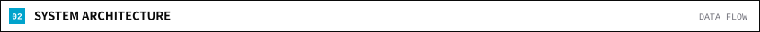
  </picture>
</p>

<p>
  <picture>
    <source media="(prefers-color-scheme: dark)" srcset="./assets/repo-arch-dark.svg">
    
  </picture>
</p>

<details>
<summary><strong>Repository Layout &amp; Specifications</strong></summary>

```text
gitskins/
├── assets/                 # Canonical logo.svg & GitSkins' own Repo Skin Light/Dark SVGs
├── cli/                    # Zero-dependency Node 18+ CLI (list / init / validate)
├── docs/                   # Engineering specs: architecture, widgets, preview, live, repo-skins
├── live-widgets/           # Zero-dependency Python stdlib live SVG generator & Actions workflow
├── scripts/
│   └── build_all.py        # Builds 11 themes (242 SVGs), validates 220 live SVGs, syncs web/public/
├── skill/gitskins/
│   └── SKILL.md            # Standard Agent Skill definition
├── themes/<theme-id>/      # Self-contained theme packs (meta.json, SPEC, PROMPT, generator.py, assets/)
└── web/                    # React + Vite static studio deployed to Cloudflare Workers Static Assets
```

**Technical Specifications:**
- [Architecture & Semantic Theme Token Contract](docs/architecture.md)
- [4-Column Bento DIY Widgets System](docs/widgets-system.md)
- [Zero-Backend Live Profile Preview & ZIP Export](docs/profile-preview.md)
- [Zero-503 GitHub Actions Live Widgets](docs/live-widgets.md)
- [Repo Skins, Agent Skill & Zero-Dep CLI](docs/repo-skins.md)

</details>

---

## Local Development

```bash
# 1. Regenerate all 11 themes (242 SVGs), validate 220 live widget SVGs, and sync web/public/
python scripts/build_all.py

# 2. Validate repository SVG assets
node cli/gitskins.mjs validate ./assets

# 3. Run the showcase studio locally
cd web && pnpm install && pnpm dev
```

---

## Roadmap & Contributing

- **Roadmap**: See [ROADMAP.md](ROADMAP.md) for shipped milestones (`v0.1`–`v0.8`) and upcoming community themes.
- **Contributing**: Want to contribute a new theme or skin-adaptive DIY widget? Read [CONTRIBUTING.md](CONTRIBUTING.md) — dropping a self-contained folder under `themes/<theme-id>/` and running `python scripts/build_all.py` automatically validates and registers it in the live studio.

If GitSkins upgraded your GitHub profile or open-source repo, consider giving it a **Star** — it helps more developers discover zero-503 static README design systems.

## Acknowledgments

Special thanks to the **[LINUX DO](https://linux.do)** community for the inspiration, feedback, and support.

## License

[MIT](LICENSE) © 2026 [Furina-he](https://github.com/Furina-he)

<p align="right">
  <a href="https://gitskins.blessc.com">
    <picture>
      <source media="(prefers-color-scheme: dark)" srcset="./assets/gitskins-badge-dark.svg">
      
    </picture>
  </a>
</p>
