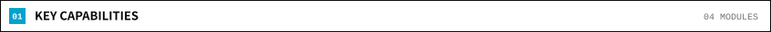
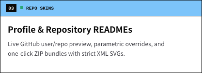
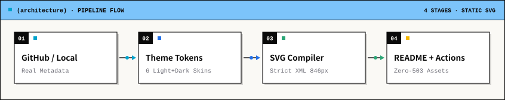

<!-- Styled with GitSkins Repo Skins (https://gitskins.blessc.com) · Theme: swiss-bauhaus-pixel -->

<p>
  <a href="https://gitskins.blessc.com">
    <picture>
      <source media="(prefers-color-scheme: dark)" srcset="./assets/repo-hero-dark.svg">
      
    </picture>
  </a>
</p>

<p>
  <picture>
    <source media="(prefers-color-scheme: dark)" srcset="./assets/repo-install-dark.svg">
    
  </picture>
</p>

<p align="center">
  <a href="https://gitskins.blessc.com"><strong>Live Studio (gitskins.blessc.com) ↗</strong></a>
  ·
  <a href="https://gitskins.blessc.com/#repo">Repo Skins</a>
  ·
  <a href="https://gitskins.blessc.com/#widgets">DIY &amp; Live Widgets</a>
  ·
  <a href="skill/gitskins/SKILL.md">Agent SKILL.md</a>
  ·
  <a href="ROADMAP.md">Roadmap</a>
  ·
  <a href="CONTRIBUTING.md">Contribute</a>
</p>

<p>
  <picture>
    <source media="(prefers-color-scheme: dark)" srcset="./assets/repo-sec-feat-dark.svg">
    
  </picture>
</p>

<p>
  <picture><source media="(prefers-color-scheme: dark)" srcset="./assets/repo-feat-01-dark.svg"></picture>&nbsp;<picture><source media="(prefers-color-scheme: dark)" srcset="./assets/repo-feat-02-dark.svg"></picture>
</p>

<p>
  <picture><source media="(prefers-color-scheme: dark)" srcset="./assets/repo-feat-03-dark.svg"></picture>&nbsp;<picture><source media="(prefers-color-scheme: dark)" srcset="./assets/repo-feat-04-dark.svg"></picture>
</p>

<p>
  <picture>
    <source media="(prefers-color-scheme: dark)" srcset="./assets/repo-sec-arch-dark.svg">
    
  </picture>
</p>

<p>
  <picture>
    <source media="(prefers-color-scheme: dark)" srcset="./assets/repo-arch-dark.svg">
    
  </picture>
</p>

---

## Curated Themes (`01`–`06`)

All 6 aesthetic systems ship with paired **Light & Dark** semantic token contracts (`meta.json#tokens`), strict XML-validated static SVGs, and full linkage across **Profile Skins**, **Repo Skins**, **DIY Bento Widgets**, and **Zero-503 Live Widgets**:

| # | Theme | Visual World | Best For | Files |
| :--- | :--- | :--- | :--- | :--- |
| `01` | **Swiss-Bauhaus Pixel Poster** | `0px` Swiss grid, geometric pixel wordmark, orthogonal weaves, blinking `28×28` avatar portrait | Indie developers, toolmakers, design engineers | [SPEC](themes/swiss-bauhaus-pixel/SPEC.md) · [PROMPT](themes/swiss-bauhaus-pixel/PROMPT.md) · [Generator](themes/swiss-bauhaus-pixel/generator.py) |
| `02` | **Architectural Blueprint CAD** | Prussian blueprint (Dark) & vellum tracing sheet (Light), millimeter grid, isometric reticle, CAD title blocks | Systems engineers, Rust/Go/infra, hardware & full-stack | [SPEC](themes/blueprint-cad/SPEC.md) · [PROMPT](themes/blueprint-cad/PROMPT.md) · [Generator](themes/blueprint-cad/generator.py) |
| `03` | **Editorial Broadsheet Zine** | Archival newsprint & obsidian press, double-rule masthead, serif headlines, vermilion folios, colophon ledger | Technical writers, architects, OSS maintainers | [SPEC](themes/editorial-zine/SPEC.md) · [PROMPT](themes/editorial-zine/PROMPT.md) · [Generator](themes/editorial-zine/generator.py) |
| `04` | **Retro CRT Terminal TUI** | Split-pane `tmux` workstation, pixel monogram, `neofetch` telemetry, ANSI 8-color bar, CLI command tabs | CLI authors, Linux/Neovim users, DevOps & backend | [SPEC](themes/crt-terminal/SPEC.md) · [PROMPT](themes/crt-terminal/PROMPT.md) · [Generator](themes/crt-terminal/generator.py) |
| `05` | **16-bit Pixel RPG HUD** | Stepped pixel bevel frames, corner rivets, HP/MP/XP stat meters, quest-log cards with `12×12` pixel relics | Game & creative devs, indie makers, retro pixel fans | [SPEC](themes/pixel-rpg-hud/SPEC.md) · [PROMPT](themes/pixel-rpg-hud/PROMPT.md) · [Generator](themes/pixel-rpg-hud/generator.py) |
| `06` | **Seal Ink Monograph** | Warm Xuan paper & obsidian inkstone, carved cinnabar red seal stamp, corner fretwork, layered mountain mist | Design engineers, writers, East Asian minimalism lovers | [SPEC](themes/seal-ink-scroll/SPEC.md) · [PROMPT](themes/seal-ink-scroll/PROMPT.md) · [Generator](themes/seal-ink-scroll/generator.py) |

---

## 14 Theme-Adaptive Widgets (`W01`–`W08` + `L01`–`L06`)

All widgets snap cleanly onto a **4-column `846px` Bento Grid** (`204 / 418 / 632 / 846px`, uniform `160px` row height) and automatically re-skin across all 6 themes:

- **8 Static DIY Widgets (`W01`–`W08`)** — instant zero-backend SVG & composite Bento Row export:
  `pixel-companion` · `now-playing` · `dev-badge` · `skill-dock` · `quote-banner` · `hero-sticker` (embeds natively onto Hero corners!) · `pixel-runway` (`846×48` animated strip) · `mini-tile` (`204×160` coffee / weather / hourglass / synth)
- **6 Zero-503 GitHub Actions Live Widgets (`L01`–`L06`)** — refreshed on schedule inside your own repo via zero-dependency Python stdlib ([live-widgets/generate_live_widgets.py](live-widgets/generate_live_widgets.py)):
  - `L01` `github-stats` — Stars, Repos, Followers, Merged PRs & language bar
  - `L02` `coding-rhythm` — 24-hour commit histogram & Early Bird / Night Owl badge
  - `L03` `rss-feed` — Latest 3 blog articles from any RSS 2.0 / Atom feed
  - `L04` `live-weather` — Free Open-Meteo real-time temperature & animated pixel sky
  - `L05` `wakatime-weekly` — 7-day coding hours, daily average & language share *(optional `WAKATIME_API_KEY`)*
  - `L06` `spotify-recent` — Currently playing / recent track vinyl deck *(optional Spotify refresh token secrets)*

---

## Three Ways to Use GitSkins

1. **Web Studio (No AI Required)** — Visit **[gitskins.blessc.com](https://gitskins.blessc.com)**, enter any GitHub username (`Profile Skins`) or `owner/repo` (`Repo Skins`) for live preview, compose Bento widgets, and click **Export ZIP** to download ready-to-push `README.md`, Light/Dark SVGs, and `.github/workflows/gitskins-widgets.yml`.
2. **AI Coding Agents (`SKILL.md` / One-Click Prompt)** — Copy any Profile, Repo, or Widget prompt from the live studio, or install the standard Agent Skill at [skill/gitskins/SKILL.md](skill/gitskins/SKILL.md) (also live at `https://gitskins.blessc.com/skill/SKILL.md`). Compatible with Claude Code, Codex, Cursor, Antigravity, Gemini CLI, and Windsurf.
3. **Zero-Dependency Node CLI (`cli/gitskins.mjs`)**:

```bash
# List all 6 themes, 14 widgets, and Repo Skin modules
node cli/gitskins.mjs list

# Scaffold a Repo Skin (Hero + Install + 4 Feature Cards + Architecture + Badge)
node cli/gitskins.mjs init --mode repo --theme blueprint-cad --repo owner/my-tool --badge --out .

# Scaffold a Profile Live Widgets workflow (.github/workflows/gitskins-widgets.yml)
node cli/gitskins.mjs init --mode profile --theme seal-ink-scroll --widgets "github-stats:2,coding-rhythm:2,wakatime-weekly:2,spotify-recent:2" --out .

# Strictly validate XML, zero-<script> safety, and prefers-reduced-motion compliance
node cli/gitskins.mjs validate ./assets
```

---

## Local Development & Specs

- Architecture & SVG rules: [docs/architecture.md](docs/architecture.md) · [docs/widgets-system.md](docs/widgets-system.md) · [docs/profile-preview.md](docs/profile-preview.md) · [docs/live-widgets.md](docs/live-widgets.md) · [docs/repo-skins.md](docs/repo-skins.md)

```bash
# 1. Regenerate all 6 themes (132 SVGs), validate 72 live widget SVGs, and sync web/public/
python scripts/build_all.py

# 2. Run the showcase studio locally
cd web && pnpm install && pnpm dev
```

## Contributing & Acknowledgments

Want to contribute a new theme or DIY widget? See [CONTRIBUTING.md](CONTRIBUTING.md).  
Special thanks to the **[LINUX DO](https://linux.do)** community for the inspiration, feedback, and support.

## License

[MIT](LICENSE)

<p align="right">
  <a href="https://gitskins.blessc.com">
    <picture>
      <source media="(prefers-color-scheme: dark)" srcset="./assets/gitskins-badge-dark.svg">
      
    </picture>
  </a>
</p>
