<!-- Styled with GitSkins Repo Skins (https://gitskins.blessc.com) · Theme: swiss-bauhaus-pixel -->

<p>
  <a href="https://gitskins.blessc.com">
    <picture>
      <source media="(prefers-color-scheme: dark)" srcset="./assets/repo-hero-dark.svg">
      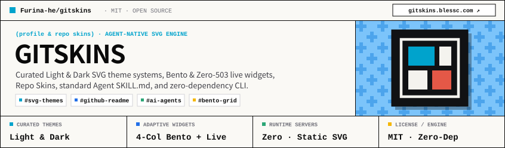
    </picture>
  </a>
</p>

<div align="center">

<p><strong>面向开发者与 AI 编程 Agent 的确定性 Light / Dark 双主题 SVG 皮肤系统、4 列 Bento 与零 503 活挂件、以及开源仓库 README 皮肤工坊。</strong></p>

<p>
  <a href="https://gitskins.blessc.com"></a>
  <a href="https://github.com/Furina-he/gitskins/stargazers"></a>
  <a href="https://github.com/Furina-he/gitskins/network/members"></a>
  <a href="#主题画廊"></a>
  <a href="#主题联动挂件"></a>
  <a href="LICENSE"></a>
</p>

<p>
  <a href="https://gitskins.blessc.com"><strong>在线工坊 ↗</strong></a>
  ·
  <a href="#主题画廊">主题画廊</a>
  ·
  <a href="#主题联动挂件">挂件系统</a>
  ·
  <a href="#快速开始">快速开始</a>
  ·
  <a href="#系统架构">系统架构</a>
  ·
  <a href="skill/gitskins/SKILL.md">Agent SKILL.md</a>
  ·
  <a href="ROADMAP.md">路线图</a>
</p>

<p>
  <a href="README.md">English</a> · <strong>简体中文</strong>
</p>

</div>

<p>
  <picture>
    <source media="(prefers-color-scheme: dark)" srcset="./assets/repo-install-dark.svg">
    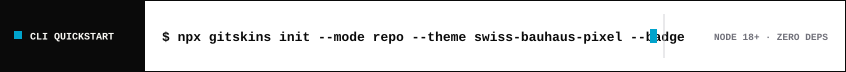
  </picture>
</p>

---

## 为什么选择 GitSkins？

传统的 GitHub 个人主页与开源项目 README 往往依赖第三方动态卡片服务，容易遭遇限流、`503` 宕机、徽章风格割裂，或在深色模式下对比度崩坏。

**GitSkins 将 GitHub README 工程化为一套零后端、确定性的设计系统** —— 所有组件输出严格 XML 校验的浅/深双主题静态 SVG，覆盖 `846px` 4 列 Bento 挂件、GitHub Actions 定时活挂件与标准 Agent `SKILL.md`。

| 对比维度 | **GitSkins** | 第三方在线统计卡片 API | 纯手工编写 SVG |
| :--- | :--- | :--- | :--- |
| **可用性与稳定性** | **100% 静态 SVG** 提交至本仓库（零 `503`、零限流） | 频繁遭遇 Vercel 冷启动、限流或宕机 | 静态稳定，但更新维护极耗时 |
| **浅色 / 深色适配** | 每套主题内置 **14 个语义令牌**，原生 `<picture>` 双图切换 | 单配色或简单反色 | 需手动维护两套坐标与色值 |
| **视觉一致性** | **个人主页 + 仓库 README + Bento + 活挂件** 全链路统一换肤 | 不同服务字号、圆角、配色割裂 | 难以跨模块复用 |
| **AI Agent 协作** | 标准 **`SKILL.md` + 零配置提示词 + CLI**（自动识别真实仓库数据） | 需手动拼接 URL 参数 | 易出现 XML 报错与文字重叠 |
| **运维成本与安全** | **$0 成本**（Python 标准库 + Actions），零 `<script>` 安全规范 | 依赖第三方服务或自建部署 | 零服务器成本，人力成本高 |

---

<p>
  <picture>
    <source media="(prefers-color-scheme: dark)" srcset="./assets/repo-sec-feat-dark.svg">
    
  </picture>
</p>

<p>
  <picture><source media="(prefers-color-scheme: dark)" srcset="./assets/repo-feat-01-dark.svg">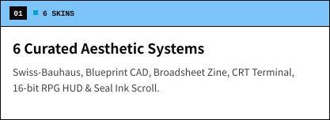</picture>&nbsp;<picture><source media="(prefers-color-scheme: dark)" srcset="./assets/repo-feat-02-dark.svg">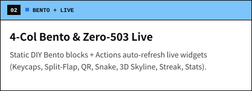</picture>
</p>

<p>
  <picture><source media="(prefers-color-scheme: dark)" srcset="./assets/repo-feat-03-dark.svg">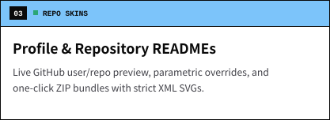</picture>&nbsp;<picture><source media="(prefers-color-scheme: dark)" srcset="./assets/repo-feat-04-dark.svg">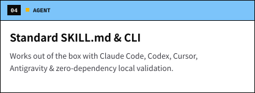</picture>
</p>

---

## 主题画廊

全部 6 套主题均配备成对 **Light / Dark** 语义令牌契约（`meta.json#tokens`）、严格 XML 校验静态 SVG（每套 `22` 张，共 `132` 张），并全链路联动 **Profile Skins**、**Repo Skins**、**DIY Bento 挂件** 与 **零 503 活挂件**。切换 GitHub 浅色/深色模式即可直接查看下方双主题实时效果：

<table>
  <tr>
    <td width="50%" valign="top">
      <a href="https://gitskins.blessc.com/#swiss-bauhaus-pixel">
        <picture>
          <source media="(prefers-color-scheme: dark)" srcset="./themes/swiss-bauhaus-pixel/assets/hero-dark.svg">
          
        </picture>
      </a>
      <br>
      <strong><code>01</code> 瑞士包豪斯像素海报（Swiss-Bauhaus Pixel Poster）</strong><br>
      <sub><code>0px</code> 锐利瑞士网格、9 行像素大字、正交编织纹理与 <code>28×28</code> 眨眼像素头像。适合独立开发者与设计工程师。</sub><br>
      <sub><a href="https://gitskins.blessc.com/#swiss-bauhaus-pixel">在线预览 ↗</a> · <a href="themes/swiss-bauhaus-pixel/SPEC.md">SPEC</a> · <a href="themes/swiss-bauhaus-pixel/PROMPT.md">PROMPT</a> · <a href="themes/swiss-bauhaus-pixel/generator.py">Generator</a></sub>
    </td>
    <td width="50%" valign="top">
      <a href="https://gitskins.blessc.com/#blueprint-cad">
        <picture>
          <source media="(prefers-color-scheme: dark)" srcset="./themes/blueprint-cad/assets/hero-dark.svg">
          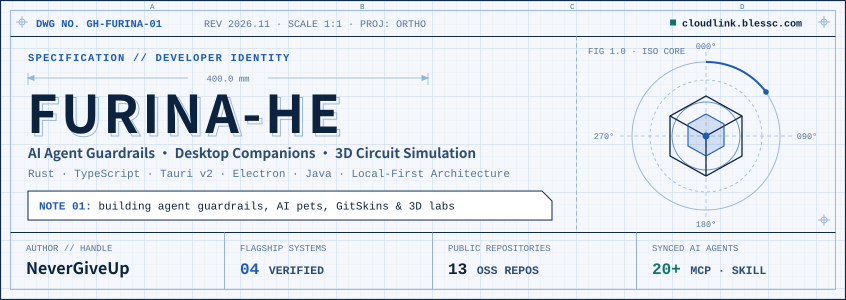
        </picture>
      </a>
      <br>
      <strong><code>02</code> 工程蓝图 CAD 制图（Architectural Blueprint CAD）</strong><br>
      <sub>普鲁士蓝图与硫酸纸质感、毫米级坐标网格、等轴测准星与 CAD 标题栏。适合系统工程、Rust/Go 与基础设施开发者。</sub><br>
      <sub><a href="https://gitskins.blessc.com/#blueprint-cad">在线预览 ↗</a> · <a href="themes/blueprint-cad/SPEC.md">SPEC</a> · <a href="themes/blueprint-cad/PROMPT.md">PROMPT</a> · <a href="themes/blueprint-cad/generator.py">Generator</a></sub>
    </td>
  </tr>
  <tr>
    <td width="50%" valign="top">
      <a href="https://gitskins.blessc.com/#editorial-zine">
        <picture>
          <source media="(prefers-color-scheme: dark)" srcset="./themes/editorial-zine/assets/hero-dark.svg">
          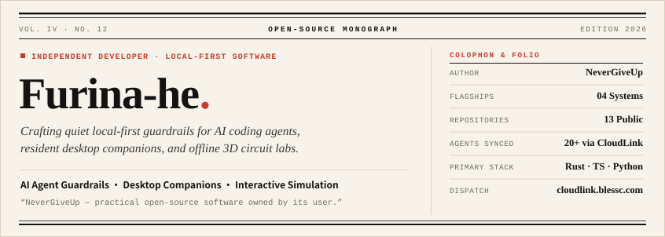
        </picture>
      </a>
      <br>
      <strong><code>03</code> 瑞士报刊杂志排版（Editorial Broadsheet Zine）</strong><br>
      <sub>典藏新闻纸与黑曜石压印、双发丝线报头、衬线大标题与规格索引栏。适合技术写作者、架构师与开源维护者。</sub><br>
      <sub><a href="https://gitskins.blessc.com/#editorial-zine">在线预览 ↗</a> · <a href="themes/editorial-zine/SPEC.md">SPEC</a> · <a href="themes/editorial-zine/PROMPT.md">PROMPT</a> · <a href="themes/editorial-zine/generator.py">Generator</a></sub>
    </td>
    <td width="50%" valign="top">
      <a href="https://gitskins.blessc.com/#crt-terminal">
        <picture>
          <source media="(prefers-color-scheme: dark)" srcset="./themes/crt-terminal/assets/hero-dark.svg">
          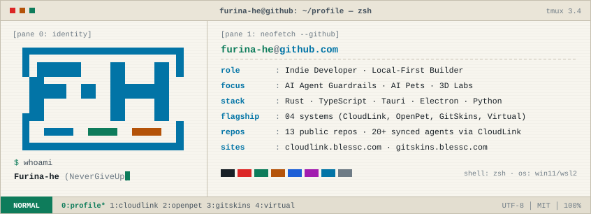
        </picture>
      </a>
      <br>
      <strong><code>04</code> 复古终端 TUI 仪表盘（Retro CRT Terminal TUI）</strong><br>
      <sub>分屏 <code>tmux</code> 工作站、像素字母徽章、<code>neofetch</code> 遥测表与 ANSI 8 色条。适合 CLI 作者、Linux/Neovim 与运维工程师。</sub><br>
      <sub><a href="https://gitskins.blessc.com/#crt-terminal">在线预览 ↗</a> · <a href="themes/crt-terminal/SPEC.md">SPEC</a> · <a href="themes/crt-terminal/PROMPT.md">PROMPT</a> · <a href="themes/crt-terminal/generator.py">Generator</a></sub>
    </td>
  </tr>
  <tr>
    <td width="50%" valign="top">
      <a href="https://gitskins.blessc.com/#pixel-rpg-hud">
        <picture>
          <source media="(prefers-color-scheme: dark)" srcset="./themes/pixel-rpg-hud/assets/hero-dark.svg">
          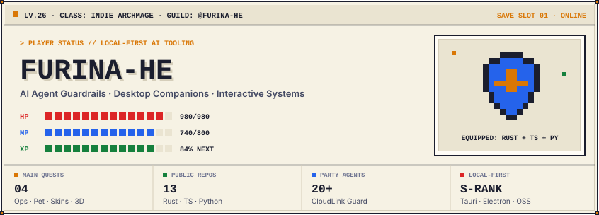
        </picture>
      </a>
      <br>
      <strong><code>05</code> 16-bit 像素 RPG 冒险面板（16-bit Pixel RPG HUD）</strong><br>
      <sub>阶梯像素斜角边框、四角铆钉、HP/MP/XP 分段槽与 <code>12×12</code> 像素遗物任务卡。适合游戏/创意开发与复古像素爱好者。</sub><br>
      <sub><a href="https://gitskins.blessc.com/#pixel-rpg-hud">在线预览 ↗</a> · <a href="themes/pixel-rpg-hud/SPEC.md">SPEC</a> · <a href="themes/pixel-rpg-hud/PROMPT.md">PROMPT</a> · <a href="themes/pixel-rpg-hud/generator.py">Generator</a></sub>
    </td>
    <td width="50%" valign="top">
      <a href="https://gitskins.blessc.com/#seal-ink-scroll">
        <picture>
          <source media="(prefers-color-scheme: dark)" srcset="./themes/seal-ink-scroll/assets/hero-dark.svg">
          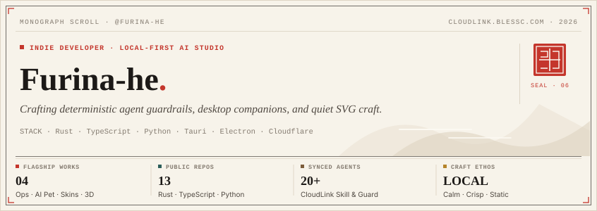
        </picture>
      </a>
      <br>
      <strong><code>06</code> 东方印章水墨卷轴（Seal Ink Monograph）</strong><br>
      <sub>暖调宣纸与端砚墨黑、朱砂雕刻方印、回纹角饰与远山叠墨层次。适合东方极简审美与设计工程师。</sub><br>
      <sub><a href="https://gitskins.blessc.com/#seal-ink-scroll">在线预览 ↗</a> · <a href="themes/seal-ink-scroll/SPEC.md">SPEC</a> · <a href="themes/seal-ink-scroll/PROMPT.md">PROMPT</a> · <a href="themes/seal-ink-scroll/generator.py">Generator</a></sub>
    </td>
  </tr>
</table>

---

## 主题联动挂件

全部 **14 款挂件** 严丝合缝对齐 **4 列 `846px` Bento 栅格**（`204 / 418 / 632 / 846px`，统一 `160px` 行高），并随当前主题自动继承全部 14 个语义令牌实现一键换肤。

### 8 款静态 DIY 挂件（`W01`–`W08`）— 零后端即时导出

| 编号 | 挂件 ID | 规格 / 槽位 | 特色 |
| :--- | :--- | :--- | :--- |
| `W01` | `pixel-companion` | 1–2 列 Bento | 眨眼/敲代码像素桌宠，支持自定义台词气泡 |
| `W02` | `now-playing` | 2–4 列 Bento | 磁带 / 黑胶循环播放机，展示最近单曲 |
| `W03` | `dev-badge` | 2–4 列 Bento | 极客状态工牌：正在构建、时区、求职状态与能量条 |
| `W04` | `skill-dock` | 2–4 列 Bento | 同皮肤技术栈机架，告别风格割裂的第三方徽章 |
| `W05` | `quote-banner` | 2–4 列 Bento | 极简宣言条幅 / 终端格言展示栏 |
| `W06` | `hero-sticker` | Hero 角落叠加 | 直接合成进 Hero 四角（扒边像素猫 / 印章 / 热咖啡 / 雷达） |
| `W07` | `pixel-runway` | `846×48` 跑道条 | 像素小宠整行巡逻 / LED 跑马灯分割线 |
| `W08` | `mini-tile` | `204×160` 迷你砖 | 像素咖啡杯、天气窗、沙漏与迷你频谱 |

### 6 款零 503 GitHub Actions 活挂件（`L01`–`L06`）

由单文件零依赖 Python 标准库脚本（[live-widgets/generate_live_widgets.py](live-widgets/generate_live_widgets.py)）在你自己的仓库内定时运行更新，**无需服务器、永不 503**：

| 编号 | 挂件 ID | 实时展示内容 | 所需密钥 |
| :--- | :--- | :--- | :--- |
| `L01` | `github-stats` | Stars、公开仓库、Followers、Merged PRs 与语言占比条 | 仅内置 `GITHUB_TOKEN` |
| `L02` | `coding-rhythm` | 24 小时提交活跃直方图 + 早鸟 / 夜猫子作息徽章 | 仅内置 `GITHUB_TOKEN` |
| `L03` | `rss-feed` | 自动拉取任意 RSS 2.0 / Atom 博客最新 3 篇文章 | 无需密钥（传 `--rss-url`） |
| `L04` | `live-weather` | 免费免 Key 接入 Open-Meteo 实时气温与像素天气动画 | 无需密钥 |
| `L05` | `wakatime-weekly` | 7 天编程总时长、日均时长与语言分布 | 可选 `WAKATIME_API_KEY` |
| `L06` | `spotify-recent` | 正在听 / 最近循环曲目黑胶唱机 | 可选 Spotify Refresh Token |

<details>
<summary><strong>查看零 503 活挂件自动刷新原理</strong></summary>

1. 在 [gitskins.blessc.com/#widgets](https://gitskins.blessc.com/#widgets) 导出 ZIP，或运行 `node cli/gitskins.mjs init --mode profile`。
2. GitHub Actions 按每 6 小时定时（或手动 `workflow_dispatch`）执行 [`.github/workflows/gitskins-widgets.yml`](live-widgets/gitskins-widgets.yml)。
3. `scripts/generate_live_widgets.py` 仅使用 Python 标准库拉取最新数据并输出严格 XML 校验的 `assets/live-*-{light,dark}.svg`，仅在内容变化时自动提交。

</details>

---

## 快速开始

根据你的习惯选择任意一种方式上手：

### 1. 在线工坊（无需 AI，30 秒完成）

1. 访问 **[gitskins.blessc.com](https://gitskins.blessc.com)**，自由切换 **个人主页皮肤**、**开源仓库皮肤** 与 **DIY & 活挂件工坊**。
2. 输入任意 GitHub 用户名或 `owner/repo`，前端直连公开 GitHub API 实时渲染你的真实头像、Stars 与项目列表。
3. 微调主强调色、卡片数量、Bento 布局与动效后，点击 **导出 ZIP** 一键下载可直接推送的 `README.md`、双主题 SVG 与 `.github/workflows/gitskins-widgets.yml`。

### 2. AI 编程 Agent（标准 `SKILL.md` / 一键提示词）

原生兼容 **Claude Code**、**Codex**、**Cursor**、**Antigravity**、**Gemini CLI** 与 **Windsurf**。

- **安装标准 Agent Skill**：使用 [skill/gitskins/SKILL.md](skill/gitskins/SKILL.md)（线上地址：`https://gitskins.blessc.com/skill/SKILL.md`）。
- **直接粘贴提示词**：在你的主页或项目仓库中发送给 AI 编程助手：

```text
请使用 GitSkins 的「瑞士包豪斯像素海报」主题改造我的 GitHub 个人主页。
请直接读取执行规范 https://raw.githubusercontent.com/Furina-he/gitskins/main/themes/swiss-bauhaus-pixel/PROMPT.md
自动通过本地 gh / git config 识别我的 GitHub 账号、头像与真实公开仓库，
生成严格 XML 校验的深/浅双主题 SVG 并确认无重叠后推送到我的同名主页仓库。
```

### 3. 零依赖 Node CLI（`Node 18+`）

克隆仓库后即可直接运行零第三方依赖的 ESM CLI：

```bash
git clone https://github.com/Furina-he/gitskins.git
cd gitskins

# 1. 查看全部 6 套主题、14 款挂件与 Repo Skin 模块
node cli/gitskins.mjs list

# 2. 为开源仓库一键脚手架生成 Repo Skin（Hero + 安装条 + 4 张特性卡 + 架构图 + 尾标）
node cli/gitskins.mjs init --mode repo --theme blueprint-cad --repo owner/my-tool --badge --out ./my-repo

# 3. 为个人主页生成零 503 活挂件 Actions 工作流
node cli/gitskins.mjs init --mode profile --theme seal-ink-scroll \
  --widgets "github-stats:2,coding-rhythm:2,wakatime-weekly:2,spotify-recent:2" --out ./my-profile

# 4. 严格校验 XML 合法性、零 <script> 安全规范与 prefers-reduced-motion 兼容
node cli/gitskins.mjs validate ./assets
```

---

<a id="系统架构"></a>

<p>
  <picture>
    <source media="(prefers-color-scheme: dark)" srcset="./assets/repo-sec-arch-dark.svg">
    
  </picture>
</p>

<p>
  <picture>
    <source media="(prefers-color-scheme: dark)" srcset="./assets/repo-arch-dark.svg">
    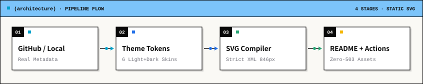
  </picture>
</p>

<details>
<summary><strong>目录结构与工程规范文档</strong></summary>

```text
gitskins/
├── assets/                 # 品牌标准图标 logo.svg 与本仓库自用的双主题 Repo Skin SVG
├── cli/                    # 零依赖 Node 18+ CLI（list / init / validate）
├── docs/                   # 架构契约、挂件系统、真身预览、活挂件与 Repo Skins 规范
├── live-widgets/           # 零依赖 Python 标准库活挂件生成器与 Actions 模板
├── scripts/
│   └── build_all.py        # 构建 6 套主题（132 SVG）、校验 72 张活挂件 SVG 并同步 web/public/
├── skill/gitskins/
│   └── SKILL.md            # 标准 Agent Skill 技能定义
├── themes/<theme-id>/      # 自包含主题目录（meta.json、SPEC、PROMPT、generator.py、assets/）
└── web/                    # React + Vite 纯静态工坊（部署于 Cloudflare Workers Static Assets）
```

**工程规范：**
- [系统架构与语义令牌契约](docs/architecture.md)
- [4 列 Bento DIY 挂件系统设计规范](docs/widgets-system.md)
- [零后端真身实时预览与 ZIP 打包规范](docs/profile-preview.md)
- [零 503 GitHub Actions 活挂件规范](docs/live-widgets.md)
- [Repo Skins、Agent Skill 与零依赖 CLI 规范](docs/repo-skins.md)

</details>

---

## 本地开发

```bash
# 1. 重新生成 6 套主题（132 张 SVG）、校验 72 张活挂件 SVG 并同步到 web/public/
python scripts/build_all.py

# 2. 校验本仓库 SVG 资产
node cli/gitskins.mjs validate ./assets

# 3. 启动本地展示工坊
cd web && pnpm install && pnpm dev
```

---

## 路线图与参与贡献

- **演进路线**：查看 [ROADMAP.md](ROADMAP.md) 了解 `v0.1`–`v0.6` 已上线功能及社区主题规划。
- **参与共建**：欢迎提交新皮肤或主题联动 DIY 挂件！请阅读 [CONTRIBUTING.md](CONTRIBUTING.md) —— 只需在 `themes/<theme-id>/` 下新增自包含目录并执行 `python scripts/build_all.py` 即可自动校验并注册到在线工坊。

如果 GitSkins 让你的 GitHub 主页或开源项目耳目一新，欢迎点亮一颗 **Star** 支持！

## 致谢

特别感谢 **[LINUX DO](https://linux.do)** 社区带来的灵感、反馈与支持。

## 开源协议

[MIT](LICENSE) © 2026 [Furina-he](https://github.com/Furina-he)

<p align="right">
  <a href="https://gitskins.blessc.com">
    <picture>
      <source media="(prefers-color-scheme: dark)" srcset="./assets/gitskins-badge-dark.svg">
      
    </picture>
  </a>
</p>
