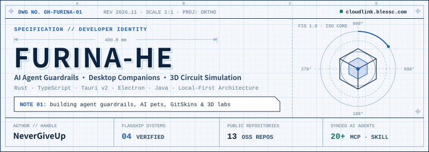
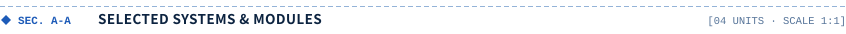
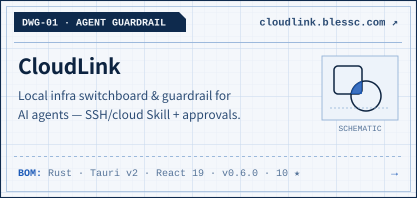
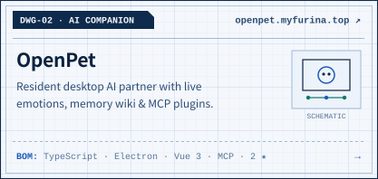
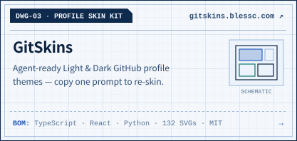
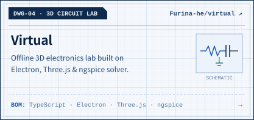

  <a href="https://cloudlink.blessc.com">
    <picture>
      <source media="(prefers-color-scheme: dark)" srcset="./assets/hero-dark.svg">
      
    </picture>
  </a>

  <a href="https://cloudlink.blessc.com"><picture><source media="(prefers-color-scheme: dark)" srcset="./assets/btn-cloudlink-dark.svg"></picture></a>
  <a href="https://openpet.myfurina.top"><picture><source media="(prefers-color-scheme: dark)" srcset="./assets/btn-openpet-dark.svg"></picture></a>
  <a href="https://github.com/Furina-he/cloudlink/releases/latest"><picture><source media="(prefers-color-scheme: dark)" srcset="./assets/btn-release-dark.svg"></picture></a>
  <a href="https://github.com/Furina-he?tab=repositories"><picture><source media="(prefers-color-scheme: dark)" srcset="./assets/btn-github-dark.svg"></picture></a>

  <picture>
    <source media="(prefers-color-scheme: dark)" srcset="./assets/sec-work-dark.svg">
    
  </picture>

  <a href="https://github.com/Furina-he/cloudlink"><picture><source media="(prefers-color-scheme: dark)" srcset="./assets/card-cloudlink-dark.svg"></picture></a>&nbsp;<a href="https://github.com/Furina-he/OpenPet"><picture><source media="(prefers-color-scheme: dark)" srcset="./assets/card-openpet-dark.svg"></picture></a>

  <a href="https://github.com/Furina-he/gitskins"><picture><source media="(prefers-color-scheme: dark)" srcset="./assets/card-gitskins-dark.svg"></picture></a>&nbsp;<a href="https://github.com/Furina-he/virtual"><picture><source media="(prefers-color-scheme: dark)" srcset="./assets/card-virtual-dark.svg"></picture></a>

Live deployments: <a href="https://cloudlink.blessc.com">cloudlink.blessc.com</a> · <a href="https://openpet.myfurina.top">openpet.myfurina.top</a> · <a href="https://gitskins.blessc.com">gitskins.blessc.com</a> &nbsp;|&nbsp; Additional modules: <a href="https://github.com/Furina-he/openpet-market">openpet-market</a> · <a href="https://github.com/Furina-he/carview">carview</a> · <a href="https://github.com/Furina-he/furina_learining">furina_learining</a>
